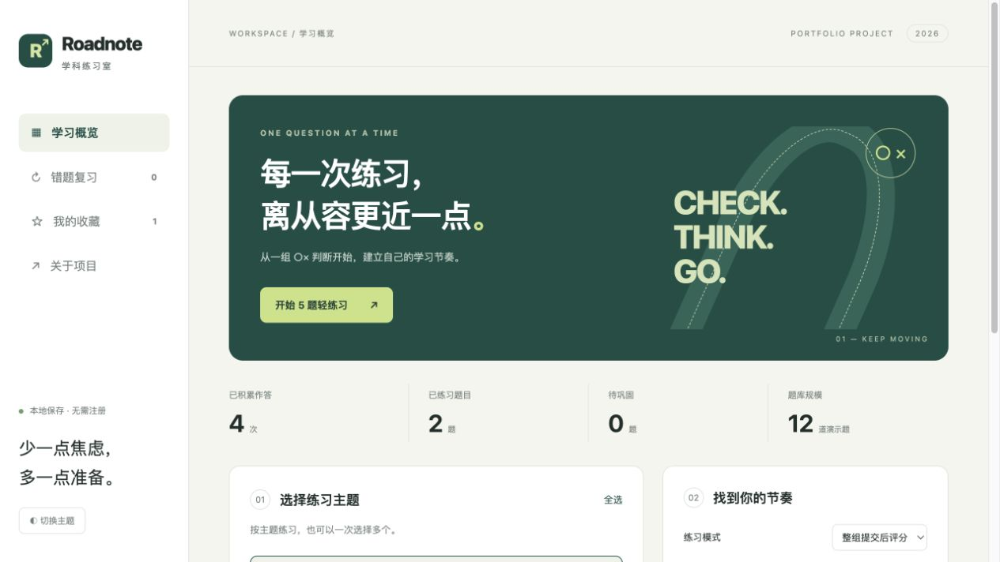

# Roadnote 学科练习室

[在线练习](https://siruiwang-615.github.io/roadnote-quiz/) · AI 辅助开发的前端练习项目。

## 四套题

| 阶段 | 试卷 | 判断项 |
|---|---|---:|
| 第一阶段 | 效果测定 A | 50 |
| 第一阶段 | 效果测定 B | 50 |
| 第二阶段 | 本免模拟 1 | 105 |
| 第二阶段 | 本免模拟 2 | 105 |

合计310个判断项，74项配有图片（49张不同图片），全部含日文、中文、答案和双语解析。第二阶段每套包括90个单项以及5组图示题，每组三项。网站按判断项统计正确数，不应用真实考试的图示题分组计分规则。限时模式统一设置为30分钟，仅为本站练习设置。

## 来源与迁移

按用户指示，从其确认持有的原仓库 https://github.com/sson-s2/menkyo-quiz 迁移上述四套题。正文、场景导语、图片、答案及双语解析保持原内容，未重新核验每条题目的法规时效。网页布局和练习逻辑由本项目重新实现。未复制原仓库的登录代码、密码或登录状态。原12道演示题仅保留稳定ID以兼容旧学习记录，不再出现在选卷列表。

## 功能

多套选卷及自动去重、15/30/50题分类均衡随机抽题、顺序或随机组题、只练未做题、随机抽50题、选答案立即核对、限时整套评分、答题卡、双语显示、原图显示、错题回练、收藏、本地断点恢复、深浅主题及JSON备份。

无需注册，无后端或云端同步。清理浏览器数据可能丢失记录，请导出备份。多标签页为最后写入覆盖，不提供并发合并。

## 运行和测试

`python3 -m http.server 8768`，打开 http://localhost:8768 。

`node --test core.test.cjs`。迁移核对包括四套数量、全部题目与图片的摘要比对、场景题组完整性、去重及旧记录兼容。

`questions.js` 为题库，`core.js` 为纯逻辑，`app.js` 负责界面与本地存储。`source-checks.json` 是迁移时的字段摘要，不含账户信息。GitHub Pages 从 main 根目录部署。

## 分类与随机队列

内部分类参考用户微信中打开的「楽勝問題／項目別問題」第一、第二阶段目录（2026-10-21）。按题干语义自动归类并修订未匹配项目，不代表原题库官方分类。随机题在题量允许时轮流覆盖不同类别。

四套共310个判断项，依据原库共享UID识别为307道不同题。随机队列按共享ID去重，并在每次出卷时即记录已抽题目；退出或刷新也不会让它立即回到未抽池。剩余少于所选题量时只出剩余题目，不重复补足；所选范围抽完后下一次抽题自动开启新一轮。其他选卷范围的记录保留。队列仅在当前浏览器存储，随JSON备份导出；不同设备需导入同一备份才能沿用。

顺序练习、错题回练与收藏回练允许主动重做。逐题核对模式选择○/×即保存判断并显示解析，整套模式仍在提交时评分。旧版已经选中但未确认的逐题练习，恢复后自动核对一次。

开始新一组时自动保存当前未完成练习，无需先结束或评分。首页「未完成练习」可选择并恢复任意保存组，保留题目顺序、位置和答案；切换出去的限时练习暂停倒计时，恢复时继续剩余时间。保存组随本地JSON备份导出。
